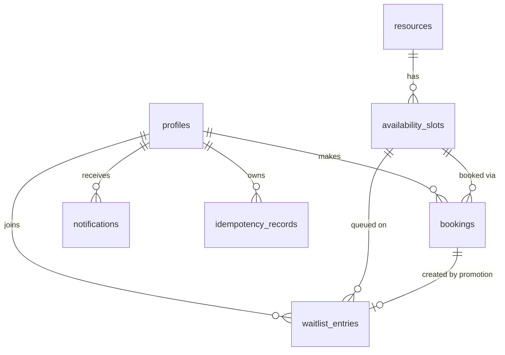

# Database design

`audit_events.actor_id` references `profiles` (SET NULL); `target_id` is a loose id.

## Invariants enforced by the database
| Invariant | Mechanism |
|---|---|
| ≤1 confirmed booking per slot | partial unique index `uix_bookings_one_confirmed_per_slot (slot_id) WHERE status='confirmed'` |
| No overlapping slots per resource | `EXCLUDE USING gist (resource_id WITH =, tstzrange(start_at,end_at,'[)') WITH &&)` (needs `btree_gist`); back-to-back allowed |
| One waiting entry per (user, slot) | partial unique index `uix_waitlist_one_waiting_per_user_slot` |
| Valid statuses/roles, `end>start`, `capacity>=1`, non-blank name, `status='cancelled' ⇔ cancelled_at IS NOT NULL` | `CHECK` constraints |
| Idempotency key unique per (user, scope, key) | `UNIQUE` |

Indexes follow query patterns: slot search `(start_at,id)` and `(resource_id,start_at)`; booking history
`(user_id,created_at,id)`; FIFO waitlist partial `(slot_id,created_at,id) WHERE waiting`; notifications and audit timelines.
Waitlist `created_at` defaults to `clock_timestamp()` so FIFO reflects real insertion order; `id` breaks ties.

## Access lockdown (migration 0002)
Every table has row-level security enabled with **no policies**, and `anon`/`authenticated` grants are revoked, so the
Supabase auto-generated REST API (reachable with the public anon key) cannot read or write app data. The FastAPI service connects
as the table owner, which bypasses RLS. A test asserts that no `public` table lacks RLS. New tables must enable RLS too.

## Transactions
One transaction per request; services never commit; routes commit once. Lock order is always
**slot row first**, then dependent rows (waitlist entries) — see ADR 0002/0004. Migrations: `alembic upgrade head`;
roll back with `alembic downgrade -1` (initial migration drops all tables, so take a `pg_dump` first in any real environment).
Data retention: bookings, waitlist entries and audit events are never deleted by the application; resources are soft-deactivated.
Test data is removed by truncating tables in the test database only (the fixtures refuse a database whose name lacks "test").
